# StepIt Speech

[](https://github.com/kineticsystem/stepit-speech/actions/workflows/ci.yml)

## Table of Contents <!-- omit in toc -->

- [StepIt Speech](#stepit-speech)
  - [Introduction](#introduction)
  - [How It Works](#how-it-works)
  - [Prerequisites](#prerequisites)
  - [Install StepIt Speech](#install-stepit-speech)
    - [Check out the Git Repository](#check-out-the-git-repository)
    - [Build the Images](#build-the-images)
  - [Running the Application](#running-the-application)
    - [Start the Rig](#start-the-rig)
    - [Start the Voice](#start-the-voice)
    - [The Speech-to-Speech Server](#the-speech-to-speech-server)
    - [Start the Browser Demo](#start-the-browser-demo)
    - [Talk to the Rig](#talk-to-the-rig)
    - [Talk From a Phone](#talk-from-a-phone)
  - [The Commands](#the-commands)
  - [Adding a Command](#adding-a-command)
  - [Trying Commands Without a Voice](#trying-commands-without-a-voice)
  - [Using It With Another Robot](#using-it-with-another-robot)
  - [Tests](#tests)
  - [Troubleshooting](#troubleshooting)

## Introduction

StepIt Speech drives a ROS 2 robot by voice. We say "move the camera 2 millimetres closer"; the robot answers "Moving closer 2 millimetres. Confirm?"; we say "yes"; and the camera moves.

It is built on [Hugging Face Speech-to-Speech](https://github.com/huggingface/speech-to-speech), which listens, transcribes, asks an LLM and speaks the answer, and on [rosbridge](https://github.com/RobotWebTools/rosbridge_suite), which lets a program reach ROS 2 over a WebSocket. Its first robot is [StepIt Macro](https://github.com/kineticsystem/stepit-macro), the focus stacking rig, but it knows nothing of it: everything about a robot is in one YAML file, its **robot file**.

- **Every command is read back and confirmed.** Nothing moves until we have heard what will run and said yes.
- **The read-back is written by the program, not by the LLM.** It comes from the robot file, word for word, the same every time.
- **The LLM cannot pretend.** It must answer every turn with a command or a short reply; a reply that sounds like the robot acting is refused.
- **Stop works without the LLM.** Saying "stop" anywhere in a sentence stops the robot at once.
- **A command is a few lines of YAML.** A description, its parameters, the sentence to read back and what to run.
- **No ROS is needed** to run the bridge or its tests: it speaks to the robot through rosbridge.

## How It Works

The bridge, `voicebridge`, sits twice in the path of Speech-to-Speech. The browser page connects to the bridge instead of the speech server, and the speech server asks its LLM through the bridge's LLM proxy:

<!-- The source is docs/diagrams/overview.mmd: change it, then run bin/render-diagrams.sh. -->
<p align="center"></p>

The LLM only proposes a command. Checking it, reading it back, hearing the yes and running it are done by the bridge, with fixed rules:

- **The bridge speaks its own sentences.** The speech server sends every reply through its LLM. When the bridge has a sentence to say, the read-back, the outcome or the greeting, the proxy answers with that sentence itself and never asks the model.
- **The LLM answers in one JSON object.** The proxy asks for `{"command": ..., "arguments": {...}}` or `{"reply": "..."}`, and the LLM server enforces it with a JSON schema: the model cannot answer a command in loose words. A command becomes the tool call the speech server expects.
- **Yes, no and stop never reach the LLM.** The bridge recognises them with fixed word lists and answers them itself.

See [docs/ARCHITECTURE.md](docs/ARCHITECTURE.md) for how it is built and why.

## Prerequisites

- Ubuntu 24.04 and [Docker Engine](https://docs.docker.com/engine/install/ubuntu/).
- An NVIDIA GPU with 16 GB VRAM for the speech server and the LLM. The speech server takes about 5.3 GB and Bonsai 2 27B about 8.2 GB: 14.5 GB together. The image of the LLM is built for the RTX 4090; see [Build the Images](#build-the-images) for another GPU.
- The NVIDIA driver, 580 or newer, and the [NVIDIA Container Toolkit](https://docs.nvidia.com/datacenter/cloud-native/container-toolkit/latest/install-guide.html), so that a container reaches the GPU.
- About 8 GB of disk for the model, which `./docker/dock.sh serve` downloads the first time.
- A robot with rosbridge. For StepIt Macro, the rig of [stepit-macro](https://github.com/kineticsystem/stepit-macro), which runs with fake motors, a fake camera and a fake Freezer by default: no hardware is needed to try it.

The tests need none of these, not even the GPU: they run in the image of the bridge, with fakes of the robot, rosbridge, the LLM and the speech server.

## Install StepIt Speech

### Check out the Git Repository

```bash
git clone --recurse-submodules git@github.com:kineticsystem/stepit-speech.git
cd stepit-speech
```

[llama.cpp](https://github.com/ggml-org/llama.cpp), which serves the LLM, and [Speech-to-Speech](https://github.com/huggingface/speech-to-speech), the speech server, are submodules, in `engines/llama.cpp` and `engines/speech-to-speech`. A clone without `--recurse-submodules` gets them the first time `./docker/dock.sh serve` runs.

### Build the Images

Three images: one holds the bridge, its tools and its tests; one holds `llama-server`, compiled with CUDA, which takes about 10 minutes on 12 cores; and one holds the speech server, with CUDA and PyTorch, about 11 GB:

```bash
./docker/dock.sh build
./docker/dock.sh build-llm
./docker/dock.sh build-speech
```

`build-llm` compiles for the RTX 4090, CUDA architecture 89. For another GPU, give its architecture, e.g. 86 for an RTX 3090: `CUDA_ARCHITECTURES=86 ./docker/dock.sh build-llm`.

## Running the Application

Five programs run together, in three terminals: one command starts the LLM, the bridge and the speech server. Start them in this order.

### Start the Rig

In the stepit-macro repository:

```bash
./docker/dock.sh start
```

Its rosbridge listens on port 9090, the address in [`robots/stepit-macro/robot.yaml`](robots/stepit-macro/robot.yaml).

### Start the Voice

```bash
./docker/dock.sh serve
```

It starts three containers on the host's network. First the LLM: `llama-server` on Bonsai 2 27B, PrismML's ternary build of Qwen3.8-27B, on port 8085, with an 8K context, which voice turns never exceed, and thinking off, so that a command comes in about half a second. Then, once the model is loaded, the bridge, and the speech server, which takes about a minute more to load speech-to-text and the voice. Ctrl-C stops all three.

For a rig on another computer, give its rosbridge; and when port 8085 is taken, another port for the LLM:

```bash
VOICEBRIDGE_ROSBRIDGE=ws://stepit.local:9090 LLM_PORT=8086 ./docker/dock.sh serve
```

The first time, it downloads the model, `Ternary-Bonsai-2-27B-Q2_0-prism-fork-required.gguf`, 7.6 GB, from [prism-ml/Ternary-Bonsai-2-27B-gguf-dev](https://huggingface.co/prism-ml/Ternary-Bonsai-2-27B-gguf-dev), into `models/`, and checks its SHA-256; an interrupted download resumes. `./docker/dock.sh models` downloads it alone.

The bridge listens for the browser on port 8766 and forwards to the speech server on `ws://127.0.0.1:8765/v1/realtime`; it listens for the speech server's LLM requests on port 8767 and forwards them to the LLM on `http://127.0.0.1:8085/v1`; and it reaches the rig at `ws://localhost:9090`. These environment variables change them:

| Variable | Default | What it is |
|---|---|---|
| `VOICEBRIDGE_LISTEN` | `0.0.0.0:8766` | Where the browser connects. |
| `VOICEBRIDGE_UPSTREAM` | `ws://127.0.0.1:8765/v1/realtime` | The speech server. |
| `VOICEBRIDGE_LLM_LISTEN` | `127.0.0.1:8767` | The LLM proxy, which the speech server uses as its LLM. |
| `VOICEBRIDGE_ROSBRIDGE` | the robot file's | rosbridge, e.g. `ws://<rig-address>:9090` for a rig on the Raspberry Pi. |
| `LLM_PORT` | `8085` | Where `llama-server` listens. |

The container cannot resolve mDNS names such as `stepit.local`. `dock.sh` resolves on the host every `.local` name in the robot file, `VOICEBRIDGE_ROSBRIDGE`, `VOICEBRIDGE_UPSTREAM` and `VOICEBRIDGE_LLM_URL`, and passes it to the bridge's container. The address is fixed when the bridge starts: when the rig's address changes, restart the bridge.

To try the bridge against another LLM server, start the bridge alone, pointed at it, and the speech server as [below](#the-speech-to-speech-server). The server must enforce a JSON schema, as `llama-server` does:

```bash
VOICEBRIDGE_LLM_URL=http://localhost:8090/v1 ./docker/dock.sh bridge
```

`VOICEBRIDGE_LLM_MODEL` names the model every request asks for, whatever the speech server names, for a server that serves several. Ours serves one, and ignores the name.

At start, it logs the robot, its commands and the proxy: `StepIt Macro: 16 commands, rosbridge at ws://localhost:9090` and `LLM proxy on http://127.0.0.1:8767/v1, forwarding to http://127.0.0.1:8085/v1`.

### The Speech-to-Speech Server

`./docker/dock.sh serve` starts it from the submodule, as the host's user, with the models of the host's `~/.cache`: `huggingface` for speech-to-text and the voice, `torch` for the voice detection, and `faster-qwen3-tts` for the voice's references. The first start downloads them there, about 5 GB; a computer that ran `uv run speech-to-speech` already has them. It points the speech server at the bridge's LLM proxy through the chat completions API, with its default voice, Qwen3-TTS's "Aiden", in 8 bits, which saves 1.6 GB of the GPU, and without summaries of older turns.

With `./docker/dock.sh bridge`, start it in the speech-to-speech repository, with the same options:

```bash
uv run speech-to-speech serve \
  --llm_backend chat-completions \
  --responses_api_base_url "http://127.0.0.1:8767/v1" \
  --responses_api_api_key "" \
  --model_name bonsai-2-27b \
  --compact_history false \
  --qwen3_tts_ggml_quantization Q8_0 \
  --min_speech_ms 192
```

It listens on `ws://127.0.0.1:8765/v1/realtime`, and on this computer only: the bridge is its client.

`--compact_history false` makes it drop the oldest turn once it keeps more than `--chat_size`, 30 by default, instead of asking the LLM to summarise the older ones. A summary would retell the bridge's read-backs as the model's own actions, which teaches it to pretend. Should a summary be asked for anyway, the proxy answers it without the model.

`--min_speech_ms 192` keeps a short "yes". With the default, 384 ms of voice, the speech server threw away most of ours, which have 200 to 350 ms: we said yes, and nothing happened.

> [!IMPORTANT]
> The speech server must reach its LLM through the bridge, port 8767, never directly, port 8085: otherwise the LLM writes the read-back in its own words, and the bridge refuses to arm a command it did not hear word for word.

### Start the Browser Demo

In the speech-to-speech repository, with the page pointed at the bridge, port 8766, instead of the server, port 8765:

```bash
npm ci --prefix demo
uv pip install -r demo/requirements.txt
export SPEECH_TO_SPEECH_URL=ws://localhost:8766/v1/realtime
uv run uvicorn --app-dir demo server:app --port 7860
```

> [!IMPORTANT]
> Keep the page's transport on **WebSocket**, its default. Over WebRTC, which its settings offer when `SPEECH_TO_SPEECH_URL` is set, the events do not go through the bridge, and the robot cannot be reached.

### Talk to the Rig

Open <http://localhost:7860>, press the button and allow the microphone. The voice says "Ready.", the `greeting` of the robot file. Then:

1. "Move the camera 2 millimetres closer."
2. The voice answers: "Moving closer 2 millimetres. Confirm?"
3. "Yes." The rail moves, and the voice says "The camera moved 2 millimetres closer."

Say "no", or anything else, to cancel; say "stop" at any time to stop the rig. When a value is missing, e.g. "move the camera closer", the voice asks for it: "How many millimetres closer?". Watch the rig in StepIt UI, <http://localhost:8070>.

To talk to someone else without the voice hearing a command, put it to sleep: "Goodnight StepIt", then "yes". Asleep, it hears only "stop", which still stops the rig, and the wake phrase, as a sentence of its own: "Wake up". The phrases are in the robot file's `sleep` section; [`commands.md`](robots/stepit-macro/commands.md) lists them.

### Talk From a Phone

The Android app of [`android-ui`](android-ui/README.md) takes the place of the browser demo, with the phone in a pocket and a headset on. It connects to the bridge on port 8766, over the Wi-Fi, and keeps listening with the screen locked. Build it and install it:

```bash
./docker/dock.sh build-android
./docker/dock.sh android
adb install -r android-ui/app/build/outputs/apk/debug/app-debug.apk
```

## The Commands

[`robots/stepit-macro/commands.md`](robots/stepit-macro/commands.md) lists every command of the rig, with what we can say, the sentence read back, and the request sent to rosbridge: moving the stage and the rail, marking the ends and running a focus stack, the test shot, the camera's settings, the live view, the lights, manual drive, stop, and questions such as "what is the rig doing?".

It is generated from the robot file, so it is always the truth: after a change of the file, regenerate it with

```bash
./docker/dock.sh shell
voicebridge docs robots/stepit-macro/robot.yaml -o robots/stepit-macro/commands.md
```

## Adding a Command

A command is an entry under `commands` in the robot file. Here is the whole of `rotate_stage`:

```yaml
rotate_stage:
  description: Turns the rotary stage, the turntable the subject stands on, by an angle.
  parameters:
    degrees: {type: number, min: 0.1, max: 360, description: "how far to turn, in degrees"}
    direction: [clockwise, counter-clockwise]
  say: Rotating {{ degrees | plural('degree') }} {{ direction }}.
  run:
    objective:
      name: RotateStageBy
      payload: {deg: "{{ -degrees if direction == 'counter-clockwise' else degrees }}"}
  done: Rotated {{ degrees | plural('degree') }} {{ direction }}.
  examples:
    - rotate the rig 10 degrees left: {degrees: 10, direction: counter-clockwise}
```

| Key | What it is |
|---|---|
| `description` | What the command does, for the LLM: it picks the command by it. |
| `parameters` | What the LLM must fill in. `[a, b]` is a choice of words; `number` or `integer` a number, with `min` and `max`; `string` any text. `optional: true` when it may be left out. |
| `say` | The sentence read back before the command runs. `{{ name }}` is a parameter. |
| `run` | What to run: a call of the robot file, `objective` here, and its values. |
| `done` | Optional: what to say once it succeeded. `failed` says what to say when it failed, with `{{ message }}`, the robot's reason. |
| `examples` | Phrases the user could say, with the parameters the LLM should give. They teach the LLM and test the command. For a command with `confirm: false`, they also give the words that ask for it: it runs only when the user's words share one with its name or its examples. |

To add one:

1. Copy a command that looks like it, e.g. `move_camera` for a move, `take_test_shot` for an objective without parameters, `set_camera` for a parameter of a node.
2. Change its name, `description`, `parameters`, `say`, `run` and `examples`.
3. Check it, without the robot: `voicebridge check robots/stepit-macro/robot.yaml` prepares every example and prints its read-back and its request, or says what is wrong and where, e.g. `commands.rotate_stage.say: unknown name degres; the names are degrees, direction, reads`.
4. Regenerate `commands.md`, as above, and restart the bridge.

A command that only answers a question, e.g. `report_status`, has no `run` and says `confirm: false`. A command that reads the robot before it is read back, e.g. `start_full_stack`, which reads the plan of the stack, has a `read`; `let` computes values from it, and `require` refuses the command with a sentence, e.g. "Set the farther mark first." The [architecture document](docs/ARCHITECTURE.md#the-robot-file) describes every key.

> [!NOTE]
> In YAML, a text with a comma inside `{ }` must be in quotes: `{description: "how far, in degrees"}`. The check says so when we forget.

## Trying Commands Without a Voice

Three tools of the image try a robot file without speaking, in `./docker/dock.sh shell`:

- `voicebridge check robots/stepit-macro/robot.yaml` prepares every example, without a robot.
- `voicebridge run robots/stepit-macro/robot.yaml rotate_stage degrees=10 direction=clockwise` prepares one command, prints its read-back and its request, asks "Run it? [y/N]" and runs it on the rig.
- `voicebridge eval robots/stepit-macro/robot.yaml` asks the LLM to understand every example, and scores it; `--say "turn the table 20 degrees"` tries a phrase of our own. It asks through the bridge's LLM proxy, `http://localhost:8767/v1`, as the bridge does, so the bridge must be running; `--model` names the model, `bonsai-2-27b` by default.

## Using It With Another Robot

Write a robot file for it: its `rosbridge` address, its `calls`, how its commands reach it, and its `commands`. The calls of standard ROS 2 interfaces, `get_parameters`, `set_parameters`, `trigger` and `read_latched_topic`, come with voicebridge, in [`src/voicebridge/robotfile/calls.yaml`](src/voicebridge/robotfile/calls.yaml). Then start the bridge with it:

```bash
./docker/dock.sh serve robots/<robot>/robot.yaml
```

The tests use a made-up robot, [`tests/robots/arm.yaml`](tests/robots/arm.yaml), a short example of a whole robot file.

## Tests

Run the checks of CI, in the image:

```bash
./docker/dock.sh test
```

They check the style with ruff, prepare every example of every robot file, and run the tests, which cover the confirmation rules, the robot file, rosbridge and the whole bridge over real WebSockets, with fakes of the speech server, the LLM and rosbridge. See [Tests](docs/ARCHITECTURE.md#tests) for what each covers and what is checked by hand.

## Troubleshooting

**The voice says "That did not work: cannot reach rosbridge at ws://localhost:9090".** The rig is not running, or its rosbridge is elsewhere: start it, or set `VOICEBRIDGE_ROSBRIDGE`.

**The voice says "That did not work: cannot reach rosbridge at ws://stepit.local:9090", but the rig is running.** The bridge runs in a container, which cannot resolve mDNS names. Start it with `./docker/dock.sh serve` or `./docker/dock.sh bridge`, which resolve the name on the host, or give the rig's address, e.g. `VOICEBRIDGE_ROSBRIDGE=ws://192.168.100.25:9090`.

**The voice says "There is no command waiting for confirmation, so nothing was done."** The bridge heard a yes, but no command was waiting: say the command itself, and answer its read-back. The speech-to-text can also mishear a word: "confirm" was once heard as "Koncern", which cancels the command. Say "yes".

**`./docker/dock.sh serve` stops with `could not select device driver "" with capabilities: [[gpu]]`.** Docker cannot reach the GPU: install the NVIDIA Container Toolkit, run `sudo nvidia-ctk runtime configure --runtime=docker`, and restart Docker.

**The LLM stops with `couldn't bind HTTP server socket` on port 8085.** Another program listens there: stop it, or start ours on another port, `LLM_PORT=8086 ./docker/dock.sh serve`.

**The voice says "Sorry, I did not get that as a command. Please say it again."** The LLM answered in words as if the robot were acting, twice. With a server that enforces the JSON schema, the second answer is always a command: this LLM server ignores the schema.

**The voice says "I could not read the command back exactly, so I cancelled it."** The speech server reached the LLM directly, not through the bridge's proxy, and the LLM read the command back in its own words: nothing moved. Point `--responses_api_base_url` at `http://127.0.0.1:8767/v1`.

**The speech server stops with `cudaMalloc failed: out of memory`, or with `CUDA error: an unsupported value or parameter was passed to the function` in `ggml_cuda_op_mul_mat_cublas`.** The GPU is full: the voice could not allocate memory. Use an LLM that leaves room for it, e.g. Bonsai 2 27B, which `./docker/dock.sh serve` starts, and nothing else on the GPU; then restart the speech server.

**A yes does nothing.** The answer must be made only of the confirming words, e.g. "yes" or "yes, go ahead", within 20 seconds of the end of the read-back. "Yes, but faster" is not a yes: it cancels the command, and the LLM hears it as a new request.
