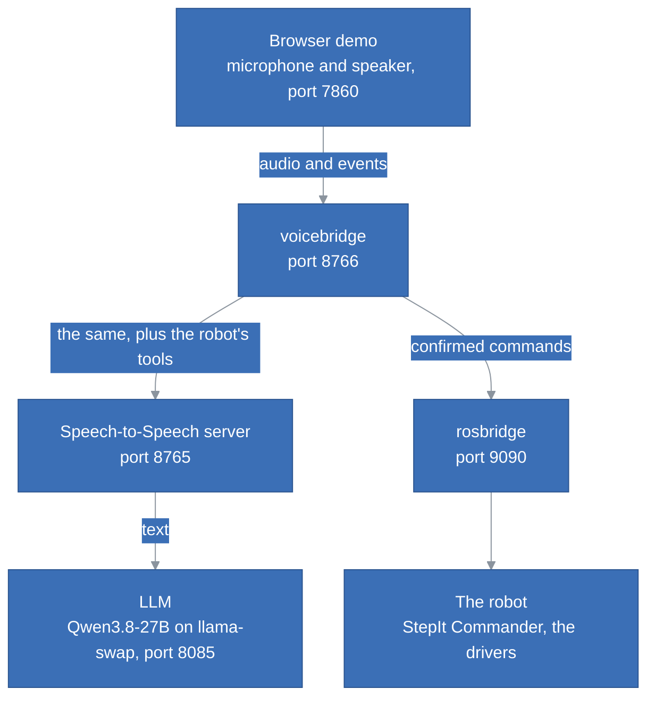

# StepIt Speech2Speech

[](https://github.com/kineticsystem/stepit-speech2speech/actions/workflows/ci.yml)

## Table of Contents <!-- omit in toc -->

- [Introduction](#introduction)
- [How It Works](#how-it-works)
- [Prerequisites](#prerequisites)
- [Install StepIt Speech2Speech](#install-stepit-speech2speech)
  - [Check out the Git Repository](#check-out-the-git-repository)
  - [Build the Image](#build-the-image)
- [Running the Application](#running-the-application)
  - [Start the Rig](#start-the-rig)
  - [Start the LLM](#start-the-llm)
  - [Start the Speech-to-Speech Server](#start-the-speech-to-speech-server)
  - [Start the Bridge](#start-the-bridge)
  - [Start the Browser Demo](#start-the-browser-demo)
  - [Talk to the Rig](#talk-to-the-rig)
- [The Commands](#the-commands)
- [Adding a Command](#adding-a-command)
- [Trying Commands Without a Voice](#trying-commands-without-a-voice)
- [Using It With Another Robot](#using-it-with-another-robot)
- [Tests](#tests)
- [Troubleshooting](#troubleshooting)

## Introduction

StepIt Speech2Speech drives a ROS 2 robot by voice. We say "rotate the rig 10 degrees left"; the robot answers "Rotating the stage 10 degrees counter-clockwise. Say yes to confirm."; we say "yes"; and the stage turns.

It is built on [Hugging Face Speech-to-Speech](https://github.com/huggingface/speech-to-speech), which listens, transcribes, asks an LLM and speaks the answer, and on [rosbridge](https://github.com/RobotWebTools/rosbridge_suite), which lets a program reach ROS 2 over a WebSocket. Its first robot is [StepIt Macro](https://github.com/kineticsystem/stepit-macro), the focus stacking rig, but it knows nothing of it: everything about a robot is in one YAML file, its **robot file**.

- **Every command is read back and confirmed.** Nothing moves until we have heard what will run and said yes.
- **Stop works without the LLM.** Saying "stop" anywhere in a sentence stops the robot at once.
- **A command is a few lines of YAML.** A description, its parameters, the sentence to read back and what to run.
- **No ROS is needed** to run the bridge or its tests: it speaks to the robot through rosbridge.

It is the successor of [s2s-ros2](https://github.com/kineticsystem/s2s-ros2), which ran commands as soon as the LLM produced them.

## How It Works

The bridge sits between the browser page of Speech-to-Speech and its server. The page connects to the bridge instead of the server, and the bridge passes everything through, except the robot's commands:



The LLM only proposes a command. Checking it, reading it back, hearing the yes and running it are done by the bridge, with fixed rules. See [docs/ARCHITECTURE.md](docs/ARCHITECTURE.md) for how it is built and why.

## Prerequisites

- Ubuntu 24.04 and [Docker Engine](https://docs.docker.com/engine/install/ubuntu/).
- An NVIDIA GPU with at least 16 GB of memory for the speech server and the LLM, as for [s2s-ros2](https://github.com/kineticsystem/s2s-ros2#prerrequisites).
- A robot with rosbridge. For StepIt Macro, the rig of [stepit-macro](https://github.com/kineticsystem/stepit-macro), which runs with fake motors, a fake camera and a fake Freezer by default: no hardware is needed to try it.

The tests need none of these: they run in the image, with fakes of the robot, rosbridge and the speech server.

## Install StepIt Speech2Speech

### Check out the Git Repository

```bash
git clone git@github.com:kineticsystem/stepit-speech2speech.git
cd stepit-speech2speech
```

### Build the Image

The image holds the bridge, its tools and its tests:

```bash
./docker/dock.sh build
```

## Running the Application

Five programs run together, each in its own terminal. Start them in this order.

### Start the Rig

In the stepit-macro repository:

```bash
./docker/dock.sh start
```

Its rosbridge listens on port 9090, the address in [`robots/stepit-macro/robot.yaml`](robots/stepit-macro/robot.yaml).

### Start the LLM

Any OpenAI-compatible server works. On our computer, llama-swap serves Qwen3.8-27B on port 8085 as `azllm-text`, the text-only variant; it loads the model on the first request, in 1 to 2 minutes.

### Start the Speech-to-Speech Server

In the speech-to-speech repository, pointing it at the LLM through the chat completions API:

```bash
uv run speech-to-speech serve \
  --llm_backend chat-completions \
  --responses_api_base_url "http://127.0.0.1:8085/v1" \
  --responses_api_api_key "" \
  --model_name azllm-text
```

It listens on `ws://127.0.0.1:8765/v1/realtime`.

### Start the Bridge

```bash
./docker/dock.sh serve
```

It listens on port 8766, forwards to the speech server on `ws://127.0.0.1:8765/v1/realtime`, and reaches the rig at `ws://localhost:9090`. The environment variables `VOICEBRIDGE_LISTEN`, `VOICEBRIDGE_UPSTREAM` and `VOICEBRIDGE_ROSBRIDGE` change these, e.g. for a rig on the Raspberry Pi:

```bash
VOICEBRIDGE_ROSBRIDGE=ws://<rig-address>:9090 ./docker/dock.sh serve
```

At start, it logs the robot and its commands: `StepIt Macro: 15 commands, rosbridge at ws://localhost:9090`.

### Start the Browser Demo

In the speech-to-speech repository, with the page pointed at the bridge, port 8766, instead of the server, port 8765:

```bash
npm ci --prefix demo
uv pip install -r demo/requirements.txt
export SPEECH_TO_SPEECH_URL=ws://localhost:8766/v1/realtime
uv run uvicorn --app-dir demo server:app --port 7860
```

> [!IMPORTANT]
> Keep the page's transport on **WebSocket**, its default. Over WebRTC, which its settings offer when `SPEECH_TO_SPEECH_URL` is set, the events do not go through the bridge, and the robot cannot be reached.

### Talk to the Rig

Open <http://localhost:7860>, press the button, and speak:

1. "Rotate the rig 10 degrees left."
2. The voice answers: "Rotating the stage 10 degrees counter-clockwise. Say yes to confirm."
3. "Yes." The stage turns, and the voice says "The stage turned 10 degrees counter-clockwise."

Say "no", or anything else, to cancel; say "stop" at any time to stop the rig.

## The Commands

[`robots/stepit-macro/commands.md`](robots/stepit-macro/commands.md) lists every command of the rig, with what we can say, the sentence read back, and the request sent to rosbridge: moving the stage and the rail, marking the ends and running a focus stack, the test shot, the camera's settings, the live view, the lights, manual drive, stop, and questions such as "what is the rig doing?".

It is generated from the robot file, so it is always the truth: after a change of the file, regenerate it with

```bash
./docker/dock.sh shell
voicebridge docs robots/stepit-macro/robot.yaml -o robots/stepit-macro/commands.md
```

## Adding a Command

A command is an entry under `commands` in the robot file. Here is the whole of `rotate_stage`:

```yaml
rotate_stage:
  description: Turns the rotary stage, the turntable the subject stands on, by an angle.
  parameters:
    degrees: {type: number, min: 0.1, max: 360, description: "how far to turn, in degrees"}
    direction: [clockwise, counter-clockwise]
  say: Rotating the stage {{ degrees | plural('degree') }} {{ direction }}.
  run:
    objective:
      name: RotateStageBy
      payload: {deg: "{{ -degrees if direction == 'counter-clockwise' else degrees }}"}
  done: The stage turned {{ degrees | plural('degree') }} {{ direction }}.
  examples:
    - rotate the rig 10 degrees left: {degrees: 10, direction: counter-clockwise}
```

| Key | What it is |
|---|---|
| `description` | What the command does, for the LLM: it picks the command by it. |
| `parameters` | What the LLM must fill in. `[a, b]` is a choice of words; `number` or `integer` a number, with `min` and `max`; `string` any text. `optional: true` when it may be left out. |
| `say` | The sentence read back before the command runs. `{{ name }}` is a parameter. |
| `run` | What to run: a call of the robot file, `objective` here, and its values. |
| `done` | Optional: what to say once it succeeded. `failed` says what to say when it failed, with `{{ message }}`, the robot's reason. |
| `examples` | Phrases the user could say, with the parameters the LLM should give. They teach the LLM and test the command. |

To add one:

1. Copy a command that looks like it, e.g. `move_camera` for a move, `take_test_shot` for an objective without parameters, `set_camera` for a parameter of a node.
2. Change its name, `description`, `parameters`, `say`, `run` and `examples`.
3. Check it, without the robot: `voicebridge check robots/stepit-macro/robot.yaml` prepares every example and prints its read-back and its request, or says what is wrong and where, e.g. `commands.rotate_stage.say: unknown name degres; the names are degrees, direction, reads`.
4. Regenerate `commands.md`, as above, and restart the bridge.

A command that only answers a question, e.g. `report_status`, has no `run` and says `confirm: false`. A command that reads the robot before it is read back, e.g. `start_focus_stack`, which reads the plan of the stack, has a `read`; `let` computes values from it, and `require` refuses the command with a sentence, e.g. "Mark the near end first." The [architecture document](docs/ARCHITECTURE.md#the-robot-file) describes every key.

> [!NOTE]
> In YAML, a text with a comma inside `{ }` must be in quotes: `{description: "how far, in degrees"}`. The check says so when we forget.

## Trying Commands Without a Voice

Three tools of the image try a robot file without speaking, in `./docker/dock.sh shell`:

- `voicebridge check robots/stepit-macro/robot.yaml` prepares every example, without a robot.
- `voicebridge run robots/stepit-macro/robot.yaml rotate_stage degrees=10 direction=clockwise` prepares one command, prints its read-back and its request, asks "Run it? [y/N]" and runs it on the rig.
- `voicebridge eval robots/stepit-macro/robot.yaml` asks the LLM to understand every example, and scores it; `--say "turn the table 20 degrees"` tries a phrase of our own. It needs the LLM, on `http://localhost:8085/v1` by default.

## Using It With Another Robot

Write a robot file for it: its `rosbridge` address, its `calls`, how its commands reach it, and its `commands`. The calls of standard ROS 2 interfaces, `get_parameters`, `set_parameters`, `trigger` and `read_latched_topic`, come with voicebridge, in [`src/voicebridge/calls.yaml`](src/voicebridge/calls.yaml). Then start the bridge with it:

```bash
./docker/dock.sh serve robots/<robot>/robot.yaml
```

The tests use a made-up robot, [`tests/robots/arm.yaml`](tests/robots/arm.yaml), a short example of a whole robot file.

## Tests

Run the checks of CI, in the image:

```bash
./docker/dock.sh test
```

They check the style with ruff, prepare every example of every robot file, and run the tests, which cover the confirmation rules, the robot file, rosbridge and the whole bridge over real WebSockets, with fakes of the speech server and of rosbridge. See [Tests](docs/ARCHITECTURE.md#tests) for what each covers and what is checked by hand.

## Troubleshooting

**The voice says "That did not work: cannot reach rosbridge at ws://localhost:9090".** The rig is not running, or its rosbridge is elsewhere: start it, or set `VOICEBRIDGE_ROSBRIDGE`.

**The voice says "I could not read the command back exactly, so I cancelled it."** The LLM did not say the read-back word for word, so the bridge cancelled the command: nothing moved. Say it again. If it happens often, the model is too small to repeat a sentence reliably.

**A yes does nothing.** The answer must be made only of the confirming words, e.g. "yes" or "yes, go ahead", within 20 seconds of the end of the read-back. "Yes, but faster" is not a yes: it cancels the command, and the LLM hears it as a new request.
