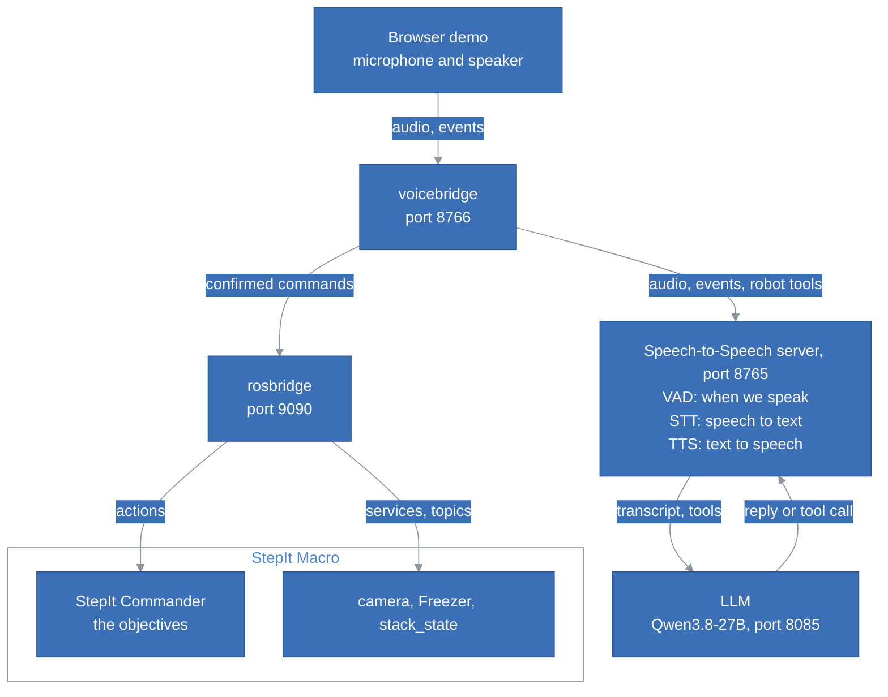
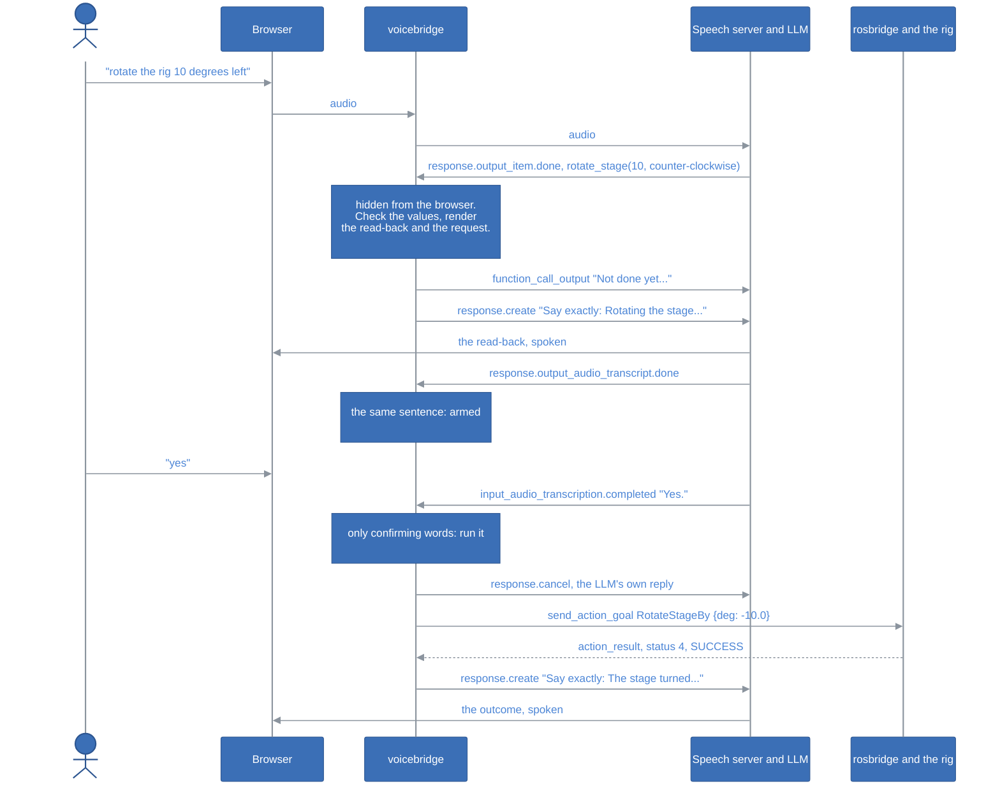
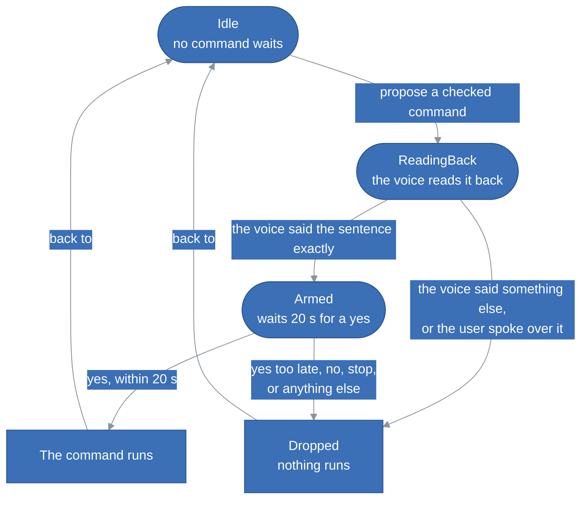
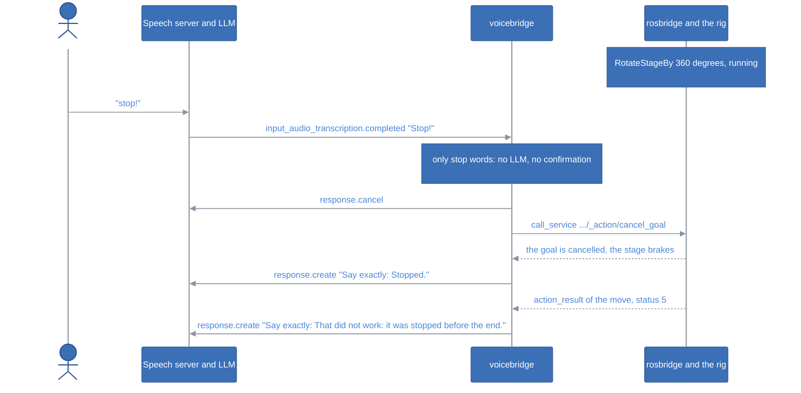
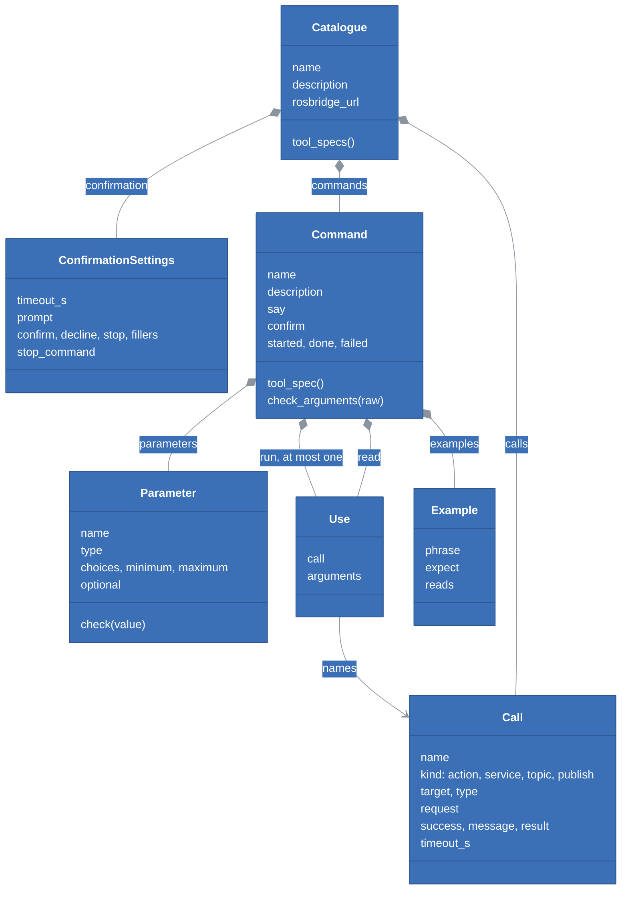
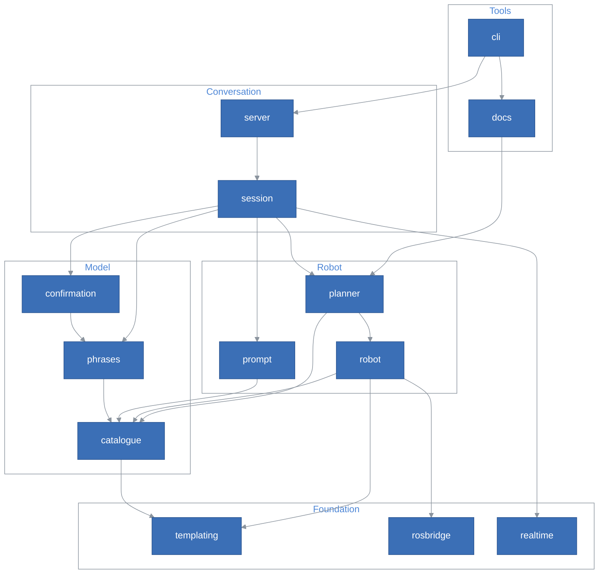
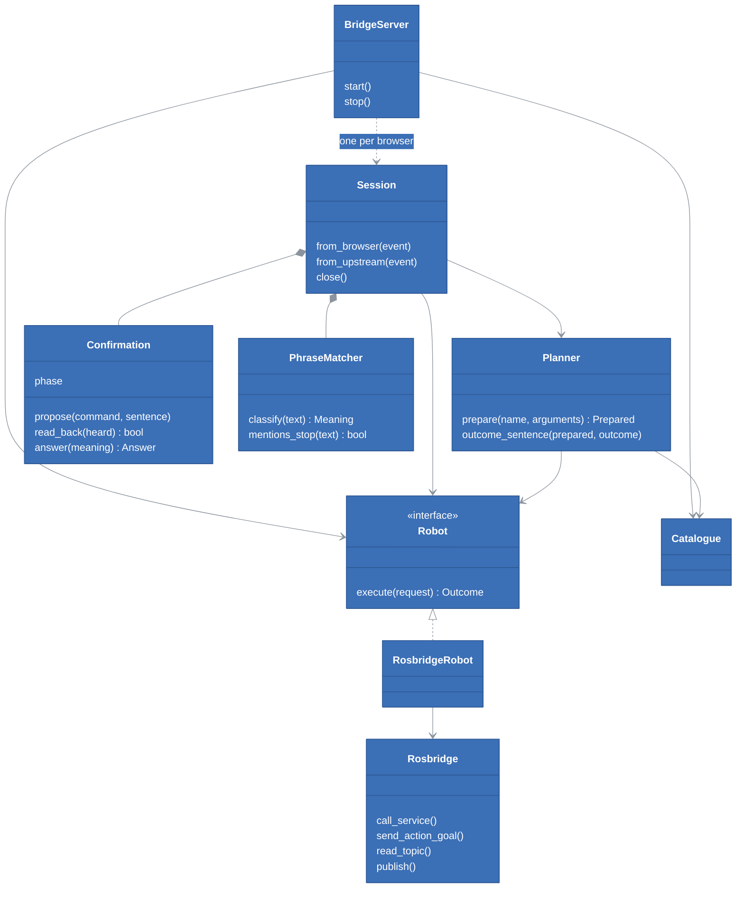
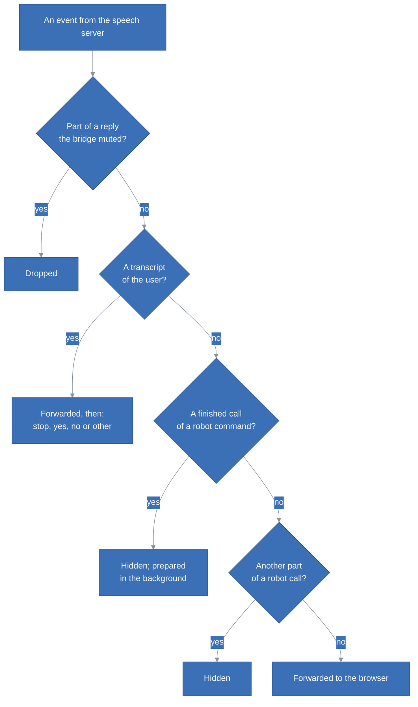

# StepIt Speech2Speech Architecture

## Table of Contents <!-- omit in toc -->

- [Introduction](#introduction)
- [The Big Picture](#the-big-picture)
- [A Command, Step by Step](#a-command-step-by-step)
- [The Safety Rules](#the-safety-rules)
  - [The Confirmation, as a State Machine](#the-confirmation-as-a-state-machine)
  - [What Can Go Wrong, and What Catches It](#what-can-go-wrong-and-what-catches-it)
  - [Stop](#stop)
- [The Robot File](#the-robot-file)
  - [Commands and Calls](#commands-and-calls)
  - [Every Key of a Command](#every-key-of-a-command)
  - [Templates](#templates)
  - [What the Loader Checks](#what-the-loader-checks)
- [The Modules](#the-modules)
- [The Objects at Run Time](#the-objects-at-run-time)
- [Inside a Session](#inside-a-session)
  - [The Events It Reads](#the-events-it-reads)
  - [The Bridge's Own Replies](#the-bridges-own-replies)
  - [Muting the Server's Reply](#muting-the-servers-reply)
- [Talking to the Robot](#talking-to-the-robot)
- [Threads and Time](#threads-and-time)
- [Tests](#tests)
- [How to Extend StepIt Speech2Speech](#how-to-extend-stepit-speech2speech)
- [Design Decisions and Trade-offs](#design-decisions-and-trade-offs)

## Introduction

This document explains how StepIt Speech2Speech is built, what each part is responsible for, and where to start when we want to change something. It assumes you have read the [README](../README.md). Its code is the Python package `voicebridge`, in `src/voicebridge`, about 2,100 lines with their docstrings; the robot it drives first is StepIt Macro, through [`robots/stepit-macro/robot.yaml`](../robots/stepit-macro/robot.yaml).

It follows one idea: **the LLM proposes, the bridge decides**. The LLM is good at understanding "spin the turntable forty five degrees anticlockwise", and bad at being certain: it can mishear, guess or invent. So it is given one job only, turning words into a proposed command. Everything that decides whether the robot moves is plain code with fixed rules: the limits of each value, the sentence read back, the check that the voice said it, the words that mean yes, and stop.

A waiter works the same way. We order in our own words; the waiter writes the order on a slip in the kitchen's words and reads it back to us; the kitchen cooks only once we said "yes, that's it". If we say anything else, the slip goes in the bin, and if we shout "stop!", everything stops, whatever is written on the slip.

## The Big Picture

Five programs take part. The bridge is the only one of this project; the others are used as they are.

The speech server and the browser speak the [OpenAI Realtime API](https://platform.openai.com/docs/guides/realtime): JSON events over a WebSocket, e.g. `session.update` from the browser, `response.created`, `conversation.item.input_audio_transcription.completed` (what we said) and `response.output_item.done` (a finished tool call) from the server. The bridge sits in the middle of that WebSocket. To the browser it looks like the server; to the server it looks like the browser. It passes almost every event through unchanged.

| Name | Type | What it does |
|---|---|---|
| `ws://0.0.0.0:8766/v1/realtime` | WebSocket server | Where the browser connects, instead of the speech server. One session per browser. |
| `ws://127.0.0.1:8765/v1/realtime` | WebSocket client | The speech server. The bridge opens one connection per browser, with the browser's own subprotocols. |
| `ws://localhost:9090` | WebSocket client | rosbridge, for every request to the robot. One connection for the whole bridge. |
| `robots/<robot>/robot.yaml` | File | Everything about the robot: its commands, how they reach it, the words of yes, no and stop. |
| `voicebridge serve`, `check`, `docs`, `run`, `eval` | Command line | The bridge, and the tools that try a robot file without a voice. |

## A Command, Step by Step

In plain words, this is what happens when we say "rotate the rig 10 degrees left":

1. The speech server hears us, transcribes us, and gives the text to the LLM, with the robot's commands as tools: the bridge added them to the session when the browser connected.
2. The LLM calls the tool `rotate_stage` with `{degrees: 10, direction: counter-clockwise}`.
3. The bridge catches the call, so the browser never sees it, and checks the values: 10 is between 0.1 and 360, counter-clockwise is one of the two directions.
4. From the same values, it writes the sentence to read back, "Rotating the stage 10 degrees counter-clockwise. Say yes to confirm.", and the request it will send, the objective `RotateStageBy` with `{deg: -10.0}`.
5. It asks the voice to say that sentence word for word, and compares what the voice said with it. Only when they are the same is the command **armed**: ready, waiting for a yes, for 20 seconds.
6. We say "yes". The bridge reads our transcript itself and finds only confirming words. The LLM's own answer to our "yes" is muted and cancelled.
7. The bridge sends the goal to the commander through rosbridge and waits for its end.
8. It asks the voice to say the outcome: "The stage turned 10 degrees counter-clockwise."

The same, as the messages between the programs:

## The Safety Rules

The bridge exists for these rules. Each one is code, not a request to the LLM, and each has tests in [`tests/test_session.py`](../tests/test_session.py) or [`tests/test_confirmation.py`](../tests/test_confirmation.py).

1. **The LLM never runs anything.** Its tool calls are proposals: the bridge catches every call of a robot command before the browser sees it.
2. **The values are checked before the read-back.** Each parameter has a type and, for a number, limits, e.g. at most 360 degrees and 50 mm: a value out of them is refused, and the LLM is told why, so that it can tell us.
3. **What is read back is what runs.** The sentence and the request are rendered together, from the same checked values, in `Planner.prepare`.
4. **The voice must say the read-back exactly.** The LLM speaks it, told to repeat it word for word; the bridge compares what it said with the sentence, ignoring case and punctuation. Anything else cancels the command, and the voice says so.
5. **Only a clear yes runs it.** The bridge decides from our transcript, with the robot file's list of words: the whole answer must be made of them, e.g. "yes", "ok go ahead", "yes please". "Yes but 20 degrees" is not a yes.
6. **The yes must come after the read-back, and in time.** A yes over the read-back, before it ended, does not count: we cannot have confirmed what we did not hear. After 20 seconds, a yes runs nothing.
7. **Anything else cancels.** "No", "wait", or any other sentence drops the command; a sentence that is not a yes or a no then goes to the LLM as a new request.
8. **Stop needs nothing.** A stop word anywhere in what we say runs the stop command at once, without the LLM and without a confirmation. See [Stop](#stop).
9. **A command never outlives its session.** When the browser disconnects, the goals the session sent are cancelled.
10. **One command per answer of the LLM.** A second tool call in the same answer is refused.
11. **What is not in the robot file cannot be said.** StepIt Macro's file leaves out switching the rig off, and the objectives that take raw radians.

### The Confirmation, as a State Machine

The pending command lives in a `Confirmation` object, in [`confirmation.py`](../src/voicebridge/confirmation.py). It holds at most one command, and is always in one of three states:

Every way out of `Armed` goes back to `Idle`, so a command is confirmed once at most. Only one arrow runs a command, and it starts from `Armed`. A newer command, proposed while one is read back or armed, replaces it and starts its own read-back. The object does no I/O and takes its clock as an argument, so the tests move time forward by hand.

### What Can Go Wrong, and What Catches It

| What goes wrong | What catches it |
|---|---|
| The STT mishears "fifteen" as "fifty". | The read-back says "50 degrees": we hear it and say no. |
| The LLM picks the wrong direction, or guesses one we did not say. | The read-back says the direction in words: we hear it and say no. Measured on Qwen3.8-27B: "turn the table 20 degrees" became clockwise. |
| The LLM asks for 400 degrees, or 2 metres. | The limits of the parameter: the command is refused before the read-back. |
| The LLM calls a tool while we only chat. | The read-back: an unexpected "Rotating the stage..." is answered with no, or with anything else. |
| The LLM says "Rotating 10 degrees clockwise" when the command is counter-clockwise. | The read-back check: the voice did not say the sentence, so the command is cancelled. |
| The LLM decides that "sure, why not" or "yes but slower" is a yes. | It is not asked: the bridge matches the words itself, and neither sentence is made only of confirming words. |
| We say yes before the read-back is over. | Rule 6: the command is dropped. |
| We say yes a minute later, to something else. | The 20 seconds have passed: nothing runs, and the voice says so. |
| The LLM speaks its own answer to our yes, e.g. "Done!" before anything ran. | The bridge mutes and cancels the server's reply to every turn it answers itself. |
| The browser tab closes during a move. | The session cancels its goals. |
| rosbridge is down. | The request fails at once, and the voice says "cannot reach rosbridge". |

What it does not catch: a command that is read back correctly, that we confirm without listening. The read-back is as safe as our attention to it. The voice stop takes about a second, the time to hear the end of our sentence and transcribe it: it does not replace the stop of the gamepad or of StepIt UI.

### Stop

The robot file lists the stop words, e.g. `stop`, `halt`, `abort`, `freeze`, and the command they run, `stop`, which cancels every goal of the commander. A stop word anywhere in a sentence stops the robot, because a stop heard by mistake costs nothing, and a stop missed is the failure that matters. Two cases:

- **Only stop words**, e.g. "stop!" or "stop stop": the bridge answers this turn itself. It drops any pending command, mutes the server's reply, runs `stop`, and says "Stopped."
- **More than a stop**, e.g. "stop the live view": the bridge runs `stop` silently, drops any pending command, and lets the LLM hear the sentence as a request: the live view is then read back and confirmed as usual.

On the rig, with its fake motors, the commander logged the cancel 1.5 seconds after the move started, and halted the tree.

## The Robot File

### Commands and Calls

A robot file has two halves, for two people:

- **`commands`**: what the user can say. Anyone can write one: it names no topic and no message type.
- **`calls`**: how a command reaches the robot over rosbridge: an action, a service or a topic, its message type, the request, and how to tell success. Someone who knows the robot's ROS interface writes them once. The calls of standard ROS 2 interfaces, `get_parameters`, `set_parameters`, `trigger` and `read_latched_topic`, come with voicebridge in [`calls.yaml`](../src/voicebridge/calls.yaml).

A command uses a call by its name, and gives it values. `rotate_stage` runs the call `objective` with a name and a payload; the call `objective` knows that this means a goal of `btcpp_ros2_interfaces/action/ExecuteTree` on `/commander/execute_objective`, and that the goal succeeded when its status is 4 and the tree returned SUCCESS. Ten of the twelve StepIt Macro commands that run something use three calls: `objective`, `set_parameters` and `trigger`.

The loader turns the file into these objects, in [`catalogue.py`](../src/voicebridge/catalogue.py). They are frozen dataclasses: once loaded, nothing changes them.

### Every Key of a Command

| Key | Needed | What it is |
|---|---|---|
| `description` | yes | What the command does. The LLM chooses a command by it, so it says it in the user's words: "the turntable the subject stands on". |
| `parameters` | no | What the LLM fills in. `[a, b]` is a choice of words; `number`, `integer`, `string` or `boolean` a value; the long form `{type, min, max, description, optional}` adds limits. The LLM sees them as the JSON schema of the tool; the bridge checks them again, as the LLM may ignore a schema. |
| `say` | yes | The sentence read back, or, for a query, the answer. |
| `run` | no | The call to run, and its values. A command without `run` is a query: it reads, says, and changes nothing. |
| `confirm` | no | `true` by default. `false` runs the command at once: only for `stop`, and for queries, which must say so. |
| `read` | no | Calls to run before the read-back, e.g. the plan of the stack. Their results are `reads.<name>`. |
| `let` | no | Values computed from the parameters and the reads, in order, e.g. `shots` from `reads.plan`. |
| `require` | no | Conditions that must hold, each with the sentence that refuses the command, e.g. `Mark the near end first.` |
| `started` | no | What to say as soon as the command is confirmed, for a long one: "The focus stack has started." |
| `done`, `failed` | no | What to say once it ended; `failed` sees `{{ message }}`, the robot's reason. Without them: "Done." and "That did not work: <reason>." |
| `examples` | no, but expected | Phrases and the arguments the LLM should give for them. The LLM sees the first four in the tool; `voicebridge check`, the tests and `commands.md` prepare every one; `voicebridge eval` scores the LLM on them. |

`Planner.prepare` uses the keys in this order: check the arguments, run the reads, compute the lets, check the requires, render `say` and `run`. Anything that refuses a command happens before the read-back, so the user never confirms a command that would be refused.

### Templates

Values are [Jinja2](https://jinja.palletsprojects.com/) templates, in [`templating.py`](../src/voicebridge/templating.py). One rule makes them work for requests as well as for sentences: **a string that is a single `{{ expression }}` keeps the type of the expression**. `"{{ -degrees }}"` is the number -10.0, not the text "-10.0"; `"{{ [shots | float] }}"` is a list. Any other string is text: `"Rotating the stage {{ degrees }} degrees"`.

The filters the robot files need:

| Filter | What it does | Example |
|---|---|---|
| `plural` | A count with its word. | `{{ 1 \| plural('degree') }}` is "1 degree" |
| `flow_yaml` | A value as one line of YAML, the payload of a StepIt objective. | `{deg: -10.0}` |
| `ros_parameters` | A mapping as `rcl_interfaces/msg/Parameter` messages; a value of none is left out. | `{iso: '400'}` |
| `param_value` | The value of an `rcl_interfaces/msg/ParameterValue`. | `[17.0]` |
| `scalar` | The first item of a list, none for an empty one. | `17.0` |
| `bit_or`, `bit_and_not` | Bits of a number, e.g. the outputs of the Freezer. | `0 \| bit_or(3)` is 3 |

A number printed into a text reads as a person says it: 10.0 is "10". The environment is sandboxed and immutable: a template cannot reach Python's internals or change its values. A name that does not exist is an error, never an empty value.

### What the Loader Checks

`load` checks the whole file before the bridge starts, and says where a mistake is: a key it does not know, e.g. `sya` for `say`; a call that does not exist; a template that does not compile; a name a template reads that is not a parameter, `reads` or a `let`, with the names it knows; an example whose arguments do not fit its parameters; a query that does not say `confirm: false`; stop words without a stop command. Two traps of YAML are handled for us: `yes`, `no`, `on` and `off` stay words, not booleans, and a key with a space, which a comma inside `{ }` creates, comes with a hint to use quotes.

## The Modules

The package is fourteen modules in [`src/voicebridge`](../src/voicebridge), in four layers. A module imports only from the layers below it.

| Layer | Module | Responsibility | Must never |
|---|---|---|---|
| Tools | `cli` | The command line: `serve`, `check`, `docs`, `run`, `eval`. | Hold logic the bridge needs. |
| | `docs` | `commands.md`, from the robot file and its examples. | |
| Conversation | `server` | The WebSocket server; one `Session` per browser, and its connection to the speech server. | Look into the events. |
| | `session` | The rules of [Inside a Session](#inside-a-session). | Decide yes with the LLM; talk to rosbridge itself. |
| Robot | `planner` | From a tool call to a `Prepared` command: checks, reads, read-back and request. | Run the command. |
| | `robot` | `render_request`, `judge`, the `Robot` port and `RosbridgeRobot`. | Know a robot's names. |
| | `prompt` | The LLM's instructions. | |
| Model | `catalogue` | The robot file: load, check, the tools of the LLM, the check of arguments. | Do I/O beyond reading the file. |
| | `confirmation` | The state machine of the pending command. | Do I/O, or read a clock of its own. |
| | `phrases` | Yes, no, stop or other, from fixed lists of words. | Ask the LLM. |
| Foundation | `templating` | Jinja2, sandboxed, with typed results and the filters. | Know of robots. |
| | `rosbridge` | The client of rosbridge's protocol. | Know of commands. |
| | `realtime` | Pure functions on the events of the Realtime API. | Do I/O. |

The imports, as they are:

Some edges are left out for clarity, e.g. `cli` imports most modules and `session` also imports `catalogue` and `robot`; none goes up a layer, and there is no cycle. One edge is worth knowing: `robot` holds both the `Robot` port and its rosbridge implementation, so `session` imports, through it, the module of the rosbridge client, without using it. The session only ever calls `Robot.execute`, and the tests give it a fake.

## The Objects at Run Time

Once `voicebridge serve` runs, these objects exist. One `Catalogue` and one `Rosbridge` connection serve every browser; each browser gets its own `Session`, with its own pending command.

Three small values travel between them. A `Request` is a call with its templates filled in: exactly what goes to rosbridge. A `Prepared` is a command with everything decided: its checked arguments, its read-back sentence and its `Request`. An `Outcome` is how a request ended: ok or not, the robot's message, and, for a read, its value.

## Inside a Session

A `Session`, in [`session.py`](../src/voicebridge/session.py), is the only place where the rules live. It has no WebSocket: it gets events through `from_browser` and `from_upstream`, and sends them through two functions it was given, `to_browser` and `to_upstream`. The tests give it two lists.

### The Events It Reads

From the browser, it changes one event: every `session.update` gets the robot's tools and the LLM's instructions added, and `tool_choice: auto`, so that the robot's tools survive whatever the browser does with its own, e.g. switching its web search off. Everything else passes unchanged.

From the speech server, each event goes through these questions, in order:

A robot call is hidden in every form the server sends it: `response.output_item.added` and `.done`, the argument deltas, which name neither the tool nor the item but only its ids, which the session remembers, and the copy inside `response.done`. The browser's own tool executor knows only its own tools: it would answer "unknown tool", racing the bridge.

### The Bridge's Own Replies

The bridge speaks by asking the server for a reply: a `response.create` with `instructions` that say "Say exactly the following text, word for word...", and `tool_choice: none`. Four rules keep these requests from colliding with the server's own work:

- **Tagged.** Each request carries `metadata: {voicebridge: vb-<n>}`, which the server echoes in `response.created` and `response.done`. The bridge tells its replies from the server's by the tag, never by timing.
- **Queued, one at a time.** A reply is sent only when no response is in progress; the next waits for the `response.done` of the one before. A server that refuses one, `conversation_already_has_active_response`, gets it again at its next `response.done`, and the browser never sees the error.
- **Tool answers first.** The server refuses a reply while a tool call has no answer, so the `function_call_output` of every call is sent before any `response.create`, and no reply is asked for while a call is still being prepared.
- **Exact.** For a read-back, the bridge collects what the voice said, from `response.output_audio_transcript.done`, and checks it at the `response.done`.

### Muting the Server's Reply

The speech server answers every turn of the user by itself: VAD, STT, LLM and TTS run as one pipeline, and there is no option to stop it. When the bridge answers a turn itself, after a yes, a no, a late yes or a stop, it must silence that answer: otherwise the LLM might say "Done!" before anything ran, or call a tool again. So the bridge sends `response.cancel`, and for the next 10 seconds mutes and cancels any reply it did not ask for. A new turn, `input_audio_buffer.speech_started`, ends the mute at once: what the server says after it answers the new turn.

## Talking to the Robot

[`rosbridge.py`](../src/voicebridge/rosbridge.py) is a client of [rosbridge's protocol](https://github.com/RobotWebTools/rosbridge_suite/blob/ros2/ROSBRIDGE_PROTOCOL.md), with the operations of StepIt UI's `rosbridge.ts`: `call_service`, `send_action_goal` and `cancel_action_goal`, `subscribe` for one message, and `publish`. It connects on first use, and again after the connection drops, e.g. while the rig restarts. It never repeats a request: a goal whose end is unknown fails, so that we are told rather than misled.

[`robot.py`](../src/voicebridge/robot.py) turns a call into a `Request` with `render_request`, and an answer into an `Outcome` with `judge`, by the call's `success`, `message` and `result` templates. They see `response`, the answer, and `status`, the GoalStatus of an action. Without `success`, an action succeeded when its status is 4 and a service whenever it answered.

| Timeout | Default | Where |
|---|---|---|
| Connecting to rosbridge | 3 s | `Rosbridge(connect_timeout_s)` |
| A service | 10 s | `timeout_s` of the call |
| A latched topic | 3 s | `read_latched_topic` |
| An objective | 2 hours | `objective` in StepIt Macro's file: a stack of 350 pictures takes about half an hour |
| A goal that runs out of time | cancelled | `send_action_goal` sends `cancel_action_goal` |

## Threads and Time

There is one thread and one asyncio event loop. The WebSocket servers and clients, the sessions and the rosbridge client all run on it. A command that runs, e.g. a focus stack of half an hour, is an asyncio task of its session, so the session keeps reading events, and hears "stop", while it runs. Closing a session cancels its tasks; cancelling the task of a goal sends `cancel_action_goal`.

[s2s-ros2](https://github.com/kineticsystem/s2s-ros2) needed a second thread for `rclpy.spin` and a pool of threads for the commands. Through rosbridge, the robot is one more WebSocket, and both disappear.

## Tests

`./docker/dock.sh test` runs [`bin/test.sh`](../bin/test.sh), as CI does: ruff, `voicebridge check` of every robot file, and pytest. The tests need no ROS, no speech server and no LLM: they use a fake robot, a fake rosbridge server and a fake speech server. The session and server tests use a made-up robot, [`tests/robots/arm.yaml`](../tests/robots/arm.yaml), which also shows that nothing in the bridge is StepIt's.

| Test | What it covers |
|---|---|
| `test_session.py` | Every safety rule: the read-back and the yes, no, anything else, a late yes, a yes over the read-back, a wrong or interrupted read-back, stop alone and inside a sentence, stop over the bridge's own speech, rejected arguments, commands without confirmation, queries, one command per answer, a busy server, the muted reply, closing during a command. |
| `test_confirmation.py` | The state machine, with a fake clock. |
| `test_phrases.py` | What counts as yes, no and stop, and what does not, e.g. "yes but 20 degrees", "right". |
| `test_catalogue.py` | The robot file: short forms, the tool of the LLM, the check of arguments, and each mistake the loader finds. |
| `test_templating.py` | Typed results, the filters, the sandbox, undefined names. |
| `test_planner.py` | The order of `prepare`, reads, refusals, outcome sentences. |
| `test_rosbridge.py` | The client against a fake rosbridge: services, goals and their cancellation, latched topics, fragments, a lost connection; how an objective is judged. |
| `test_realtime.py` | Injecting the tools, finding and hiding robot calls, tags. |
| `test_server.py` | The whole bridge over real WebSockets: a browser with the Agents SDK's subprotocols, a fake speech server and a fake rosbridge, from the tool call to the goal. |
| `test_stepit_macro.py` | StepIt Macro's file: every example prepares; left is counter-clockwise and negative, closer is negative; the plan of a stack, its marks, the lights' bits; no power off; `commands.md` is up to date. |

Not tested automatically, and how to check it by hand:

- **The LLM's understanding.** `voicebridge eval` scores it on the examples, and on phrases of our own with `--say`. Qwen3.8-27B understood 35 of 35 examples and 20 of 20 other phrasings; with the rule against guessing, it asks back for "a bit closer" and "nudge the rail forward", but still chose a direction for "turn the table 20 degrees" and "move the camera 3 mm".
- **The real rig.** `voicebridge run` sends one command through rosbridge. Every command of StepIt Macro was run on the rig with its fake hardware; `TakeShot` and `FocusStack` fail there, as the fake camera does not see the fake Freezer's shots.
- **The real speech server and the voice.** Not tested yet: the read-back check, the mute and the tags rely on the events of the speech server's code, read in its repository. Talk to the rig as in the README, and watch the bridge's log, which names every proposal, read-back, answer and outcome.
- **WebRTC.** Not supported: see [Design Decisions and Trade-offs](#design-decisions-and-trade-offs).

## How to Extend StepIt Speech2Speech

**Add a command.** Copy one that looks like it in the robot file, change it, and run `voicebridge check`; the [README](../README.md#adding-a-command) has the steps. Add `examples`: they teach the LLM, test the command, and fill `commands.md`. Regenerate `commands.md` and restart the bridge.

**Add a call.** When a command needs a part of the robot no call reaches, add a call under `calls`: one of `action`, `service`, `topic` (a read) or `publish`, its `type`, its `request` with templates for the values commands give it, and `success` and `message` when the answer says more than "it answered". A call of a standard ROS 2 interface belongs in `src/voicebridge/calls.yaml`, for every robot.

**Add a filter.** When a template would be hard to read without one, e.g. `plural`, add it to `_make_environment` in `templating.py`, with a test. Keep the robot files readable by someone who does not know Jinja2.

**Drive another robot.** Write its robot file and start the bridge with it. Nothing in `src/voicebridge` names a robot.

**Move StepIt Macro's file into the rig.** The file can live in stepit-macro, next to `rig.yaml`, with this project as a module of the rig: the bridge only needs its path.

**Add a transport.** A WebRTC browser would need the bridge to be the WebRTC peer, or the speech server to offer a hook: the `Session` would not change, as it only sees events.

## Design Decisions and Trade-offs

**rosbridge, not rclpy.** The bridge reaches the robot through rosbridge, which StepIt Commander runs on port 9090 for StepIt UI already. It needs no ROS installation, no DDS configuration and no second thread, runs anywhere, and is tested without ROS. The price: a message type rosbridge does not know fails at run time, not at start, and every request is a JSON round trip through one more program.

**YAML templates, not Python plugins.** s2s-ros2 made each command a Python package with an entry point. Here a command is a dozen lines of YAML: anyone who can read the rig's objectives can add one, and the loader checks it before anything runs. The price: a command that needs real logic, e.g. a loop, does not fit; it becomes an objective of the commander, which is where the logic of the rig belongs anyway.

**One tool per command.** Each command is a tool of its own, with the schema of its parameters, not one generic tool with a command name. The LLM chooses better among named tools, and the schema guides its values. The price: the LLM's prompt grows with the commands: for StepIt Macro's fifteen, the tools are about 6,300 characters and the instructions 1,800.

**The LLM speaks the read-back, and the bridge checks it.** The bridge has no voice of its own: only the speech server's TTS speaks, and it speaks what the LLM writes. So the bridge tells the LLM to repeat the sentence word for word, and compares what it said with the sentence. A sentence it changes cancels the command. A TTS in the bridge would be exact, at the price of a second voice and a second model on the GPU.

**Fixed words for yes, never the LLM.** Whether we confirmed is decided by matching our transcript against lists of the robot file. An LLM would understand "go on then"; it would also find a yes where there is none. The price: a yes not on the list cancels, and we say it again.

**Stop anywhere, at once.** A stop word anywhere in a sentence stops the robot, before the LLM has heard it. The price: "stop" can never be part of another command; "stop the live view" also stops the rig, then stops the live view.

**Muting the server's reply, not preventing it.** The speech server answers every turn, and has no option to let a client decide. The bridge cancels and mutes the reply to a turn it answers itself. The price: with speculative turns, the first audio of that reply may reach the browser before the transcript does; it is cut, but can be heard for a moment.

**A session cancels its goals when it ends.** A tab that closes during a focus stack stops it. We cannot stop by voice a robot whose session is gone, so the bridge does not let one move. The price: a long stack needs the page to stay open, as StepIt UI's sliders do.

**Read the robot each time, keep nothing.** A command that needs the robot's state, e.g. the plan of a stack, reads it before its read-back, every time. The bridge keeps no copy that could be stale. The price: a read before the read-back, a few milliseconds.

**`commands.md` is generated.** The list of commands is written from the robot file, by preparing every example, and a test fails when it is out of date. It cannot drift from what the bridge does. The price: its wording is that of the generator, and the robot file is the place to change it.
