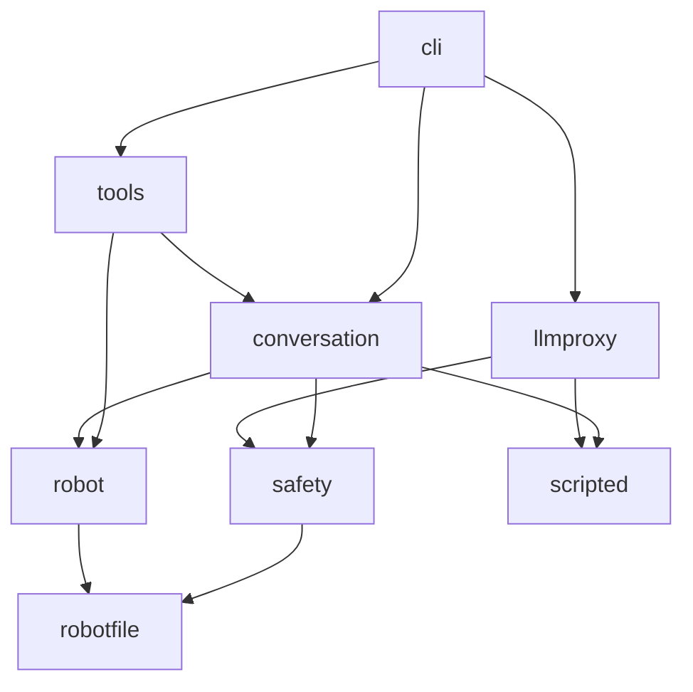

# Split voicebridge by Function

## Goal

`voicebridge` was fifteen modules in one flat folder, about 3,200 lines. Nothing told a reader which modules belong together, and three modules did two jobs each. The goal is a package that reads in parts, with no change of behaviour.

## Decisions

The package has six packages and two single modules: `robotfile`, `safety`, `robot`, `conversation`, `llmproxy` and `tools`, plus `scripted` and `cli`. Each package's `__init__.py` lists its modules in one line each.

A module that did two jobs became two:

- `catalogue.py` became `robotfile/model.py`, what a robot file holds, and `robotfile/loader.py`, how it is read and checked.
- `llmproxy.py` became `proxy` (the HTTP server and the order of its answers), `decision` (the JSON schema and its answer), `guard` (a reply that pretends) and `chat` (the messages of chat completions).
- `session.py` kept the rules; a new `Speaker`, in `conversation/speaker.py`, took the plumbing of the bridge's replies: the queue, the tags, one reply at a time, what the voice said, and the mute.
- `robot.py` became `robot/request.py`, the `Robot` port, and `robot/rosbridge_robot.py`, its rosbridge implementation. The session no longer imports the rosbridge client, even indirectly.
- `cli.py` kept the arguments and `serve`; `check`, `run` and `eval` moved to `tools/`, next to `docs`.

The tags of a sentence of the bridge, `exact_speech` and `scripted_sentence`, moved from `realtime.py` to `scripted.py`. They are the one contract between `conversation` and `llmproxy`, which now never import each other.

`tests/test_layers.py` reads the imports of every module and fails when a part imports a part it should not.

## Left Out

No re-exports in the packages' `__init__.py`: there is one way to import a name, its module.

The test files keep their names, e.g. `test_realtime.py` tests `conversation/events.py`.
