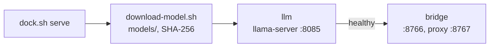

# The LLM in the Project

## Goal

The voice's LLM, Bonsai 2 27B, was served from another repository, `qwen-4090-bench`, by llama-swap. StepIt Speech must run on its own, without llama-swap: `./docker/dock.sh serve` downloads the model, starts `llama-server` on it, and then the bridge.

## Decisions

llama.cpp is a Git submodule, `engines/llama.cpp`, pinned to release b11840. Bonsai's `Q2_0` weights need b11555 or newer, and b11840 is the release tested with the voice.

`llama-server` has an image of its own, `docker/llm.Dockerfile`, compiled with CUDA 13.0 for the RTX 4090 (architecture 89). The image of the bridge and the tests does not change: CI never compiles CUDA, and the tests need no GPU. `models/` and `engines/` are left out of the bridge's build context.

`docker/compose.yaml` starts both containers on the host's network. The bridge waits until `llama-server` answers `/health`, when the model is loaded. Ctrl-C, or the end of either container, stops both.

The model is pinned to a revision of its Hugging Face repository and checked with its SHA-256. The file gets its final name only once the check passes, so a file of that name is always whole and is not hashed again on every start.

Thinking is off on the server, with `--reasoning off`. A command is one JSON object, already constrained by the schema; thinking would only make each answer slower.

`--parallel 1`: one voice, so one slot gets the whole 8K context.

No web UI, `--no-ui`, and none in the build: the bridge is the only client, and the prebuilt UI would be downloaded at build time.

No llama-swap: one model, always loaded, so nothing loads another model in its place. The model is called `bonsai-2-27b`, its alias in `llama-server`; `llama-server` ignores the name a request gives, so the bridge no longer sets one.

`./docker/dock.sh bridge` runs the bridge alone, against another LLM server, to try one.

## Left Out

No CI job builds the LLM image: it takes about 10 minutes on 12 cores and a large CUDA image, and no runner has a GPU to try it on.

The speech server still starts on its own; `TODO.md` keeps it for later.
