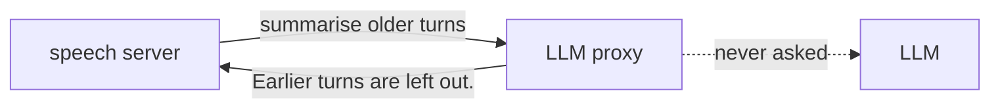

# Summary Off

## Goal

The speech server summarises older turns once its history grows past `chat_size`, by asking its LLM, with no tools. The proxy passed that request to the model, which retold the bridge's read-backs and outcomes as its own actions: "The assistant rotated the stage". The proxy cannot recognise a paraphrase to remove it, and a model that sees itself acting starts to pretend. The goal is a history without such a summary.

## Decisions

The speech server starts with `--compact_history false`, in the README. It then drops the oldest turn instead of asking for a summary.

The proxy also answers a summary request itself, without the model, in case the speech server is started with summaries on. The bridge decides, whatever the speech server's settings.

It finds the request by its instructions, which ask for the JSON fields `user_summary` and `assistant_summary`, in a request without tools.

It answers "Earlier turns are left out." on both sides. Not an empty summary: the speech server refuses a summary with an empty field, keeps every turn, and evicts only at twice `chat_size`, which could overflow the 8K context of the LLM.

The proxy removes both sentences from every later request, as it removes the bridge's own sentences.

## Left Out

A shorter history, `--chat_size 8`, needs a check on the GPU computer: it stays in `TODO.md`.
