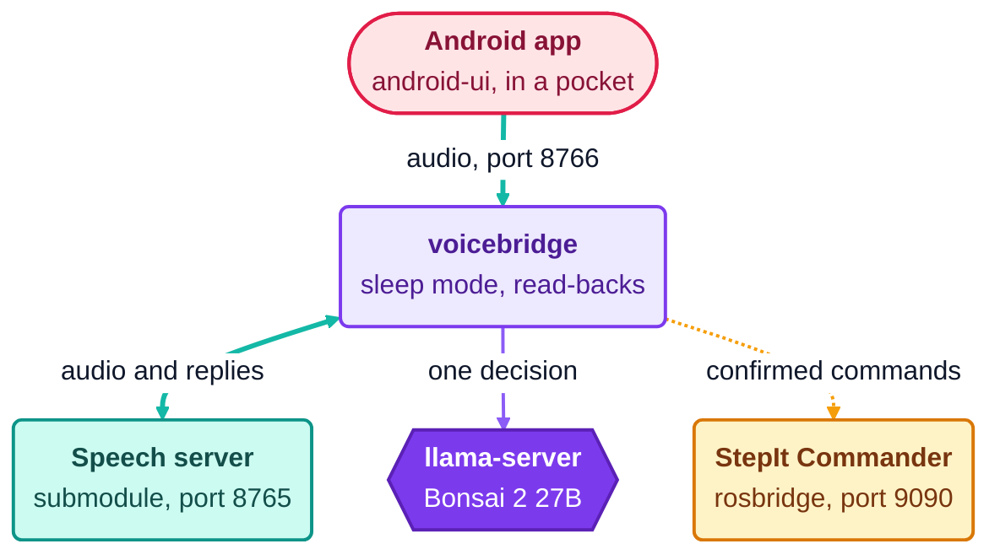

# Hands-Free: The Android App, Sleep Mode and the Whole Voice in Serve

## Goal

Control the rig hands-free, from an Android phone in a pocket with a headset: steps 1 and 3 of `TODO.md`, and the tool of its step 2, the pocket test. On the way, `./docker/dock.sh serve` starts the whole voice, the speech server included.

## Decisions

### The Android App

A native app, in Kotlin, not a web page or Capacitor. The heart of the app is the audio with the screen locked, and that is native code in every form: one language and one toolchain is simpler than a WebView in front of a plugin.

We lose a desktop version. The browser demo already is one, so the bridge's changes are tried on the computer without the app.

Android 11 or newer, the Moto G9's version. A foreground service of type `microphone`, the way Android lets an app listen with its screen locked, starts with Android 11.

The app decides nothing. It sends the microphone, plays the voice, cuts it as soon as we speak, and shows the state. The bridge keeps every rule.

It talks to the bridge as the browser demo does: a `session.update`, then an opening message that the bridge answers with the robot's greeting.

After a drop it reconnects, with a new session of the bridge, and logs the drop and how long it lasted. That log is the data of the pocket test.

The logic is in `protocol` and `voice`, behind interfaces for the microphone and the speaker, so that its unit tests run on the JVM against a fake bridge, OkHttp's `MockWebServer`. The audio, the service and the screen stay thin.

It builds in Docker, in an image of its own, `docker/android.Dockerfile`. The test image and CI stay as they are.

### Sleep Mode

Going to sleep is a command. We say it in our own words, "go to sleep" or "goodnight StepIt", the LLM proposes it, and the bridge reads it back and waits for the yes. A sleep heard by mistake is undone only by the wake phrase, so it is worth a confirmation.

It is the only command that does not reach StepIt Commander. It has no call: the session falls asleep instead.

Waking up is one exact phrase, "Wake up", matched by the bridge. The LLM cannot do it: it hears nothing while the voice sleeps. The phrase must be the last sentence of the turn, with no fillers; case and punctuation do not count. The robot file lists the spellings speech-to-text writes.

At first the whole turn had to be the phrase. On the first try by voice it never woke: while the voice sleeps, the speech server keeps the turn open after each cancelled reply, and the transcript grew to "Can you hear me? Hello, can you hear me? Wake up it. Wake up. Step it." So the phrase now only has to end the turn, as sentences of its own: "please wake up" still does not wake it.

The phrase was "Wake up, StepIt" at first. It is now "Wake up", shorter to say, and with no name for speech-to-text to spell in several ways ("Step it", "stepped"). Waking moves nothing, so a phrase said by chance costs little.

Waking needs no confirmation, as it moves nothing. Sleep moves nothing either: a running focus stack goes on, and stop works asleep or awake.

A session starts awake. We only need the wake phrase after we put the voice to sleep ourselves.

The phrases are a section of their own in the robot file, `sleep`, not a command among the others. The loader builds the command `sleep` from it, so the command has one name for every robot, and no command needs an exception to "nothing to run means a query". Where the voice's settings live, in this project or elsewhere, is still to decide: moving the section is a small change.

No sleep phrase may hold a stop word: the loader refuses it. "Stop listening" would stop the rig before the LLM heard the rest.

The proxy finds the state from the bridge's two sentences, on falling asleep and on waking up, in each request's history, so it shares no state with the session. Asleep, it answers with nothing; awake, it drops the turns in between, the wake phrase included.

The session tells its client the state and the phrases, `voicebridge.state`, after the first `session.update` and at every change. The phone shows them; the browser demo ignores the event.

Without help, the model answered about one "go to sleep" in three with "Goodnight." and called nothing. The speech server's own voice rules, "Speech is the default" and "If unsure whether a tool is needed, just speak", push it to talk. So the LLM's instructions tell it to call `sleep`, and the guard takes a reply about sleeping for pretending, and asks again with commands only. Replayed with the speech server's real prompt: 24 of 24, from 15 of 24.

### The Speech Server in Serve

Speech-to-Speech is a submodule, `engines/speech-to-speech`, as llama.cpp is. It is pinned at `da47c74`, the commit we ran by hand, so the voice does not change under us when upstream does.

It has an image of our own, `docker/speech.Dockerfile`, built from the submodule, as `docker/llm.Dockerfile` is built from llama.cpp. It follows upstream's Dockerfile with two changes.

NLTK's data goes to `/usr/share/nltk_data`. Upstream puts it in `/root`, which the host's user cannot read.

It runs as the host's user, with `HOME` at `/home/voice`. The models stay in the host's `~/.cache`, owned by the user, and shared with `uv run speech-to-speech`: nothing is downloaded twice.

`dock.sh` makes the three cache folders before starting. A folder that docker makes for a volume belongs to root.

The options are those of the README's `uv run` command: the bridge's LLM proxy on 8767, no summaries of older turns, the voice in 8 bits. It listens on 127.0.0.1 only: the bridge is its only client.

Its voice detection keeps speech from 192 ms, not 384, its default. On the first day by phone, most of our yeses were thrown away: a short "yes" has 200 to 350 ms of voice. The price: a shorter noise can make a turn too.

The old image `stepit-speech2speech` is not used. It is an old build of the bridge, from before the project's name changed, not a speech server.

### Found by Voice

An empty transcript, a noise that speech-to-text made nothing of, dropped the command waiting for its yes. It now cancels nothing.

`manual_drive` says "Enabling teleoperation." and "Teleoperation enabled.", not "Handing the rig to the gamepad.": simpler, and the gamepad may not be connected at all.

## Left Out

The sleep mode: the app shows `voicebridge.state` once the bridge sends it, step 1 of `TODO.md`.

An Android job in CI, and a test on a device or the emulator: the audio and the service are checked by hand.

A lock file. Upstream commits none, so the dependencies are resolved when the image is built: two builds a month apart may differ.

A health check of the speech server: the bridge reaches it only when a browser or the phone connects, so the order of starting needs none.

`voicebridge eval` asks the model without the speech server's voice rules, so it scored "go to sleep" 30 of 30 while the voice missed one in three. Replaying with the real prompt found it.

## Open Items

The pocket test itself, on the Moto G9, with a wired and a Bluetooth headset.

Whether the bridge gives a session a grace period to reconnect, if the test shows drops.

Falling asleep after a quiet spell.

Whether an outcome that comes while asleep is said at once or at the wake.

A turn of fillers alone, e.g. "Uh.", still drops a command waiting for its yes. With voice detection at 192 ms, a cough can make one.

Where the voice's settings, the robot files, live: StepIt Macro knows nothing of the voice.
